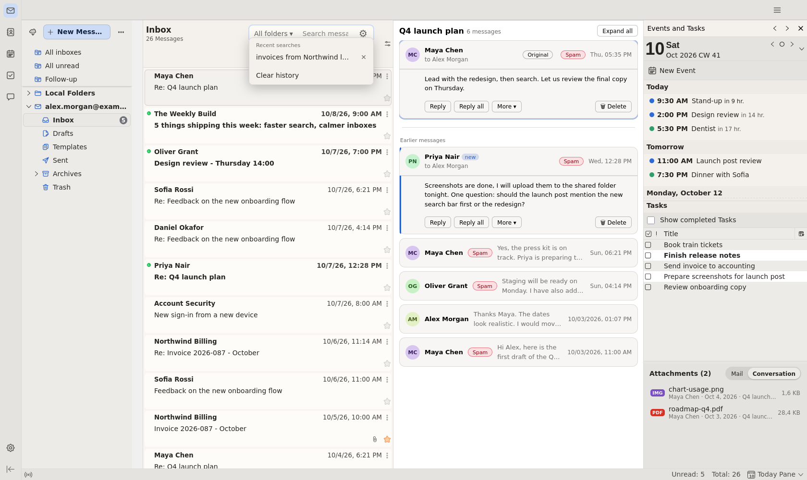
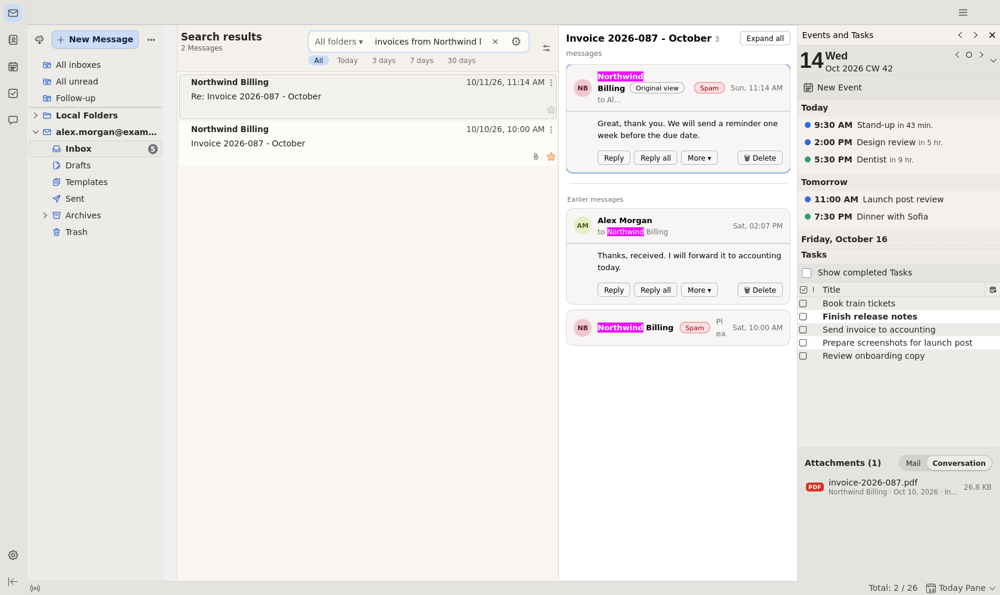
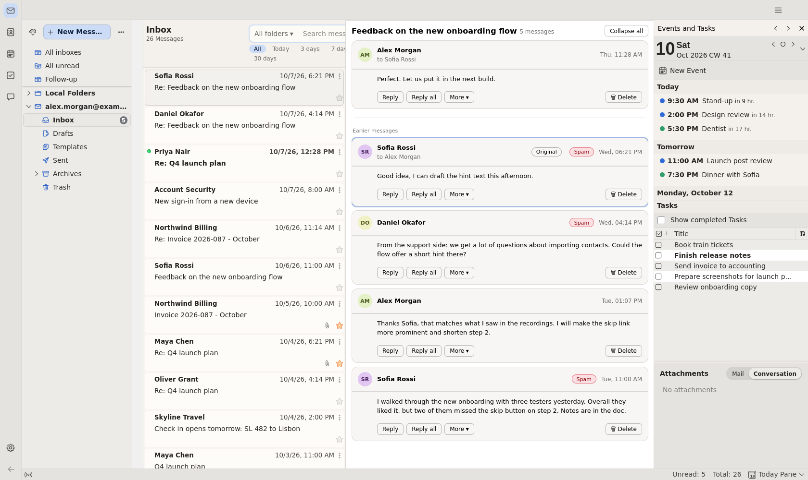

<h1 align="center">NovaBird 2.0</h1>

<b>Ein modernes Gesicht und deutlich mehr Funktionen für Thunderbird/Betterbird.</b> 
Neu in 2.0: KI-Assistent, Suche nach Bedeutung, Team-Kalender.

<a href="#neu-in-20">Neu in 2.0</a> ·
<a href="#größere-fehlerbehebungen">Fehlerbehebungen</a> ·
<a href="#installieren">Installieren</a> ·
<a href="#die-add-ons">Add-ons</a> ·
<a href="#datenschutz">Datenschutz</a> ·
<a href="#disclaimer">Disclaimer</a> ·
<a href="HANDBUCH.md">Handbuch</a> ·
<a href="README.md">English</a>

## Neu in 2.0

Alles Neue ist freiwillig. Einzelheiten stehen im [Changelog](CHANGELOG.md).

### KI-Assistent
Aus, bis du ihn einschaltest. Läuft mit Ollama, einem OpenAI-kompatiblen Server oder dem NovaBird Helper. Jede Funktion lässt sich einzeln abschalten.

- **Zusammenfassen, Übersetzen, Termine** für jede Mail. In den Kalender kommt nichts, bevor du speicherst.
- **„Was ist neu?“** Neue Mails auf einen Blick: zu erledigen, zur Info, Werbung. Auf Wunsch nach Zeitplan.
- **Schreiben:** Antwort entwerfen, korrigieren, Ton ändern oder übersetzen im Verfassen-Fenster.
- **Fristen** aus deinen Mails, mit Erinnerung.
- **Einsortieren (Beta):** Ordner in eigenen Worten beschreiben, die KI verschiebt neue Mails dorthin. Zuerst nur als Vorschlag, jederzeit rückgängig.
- **Vorlesen** mit natürlicher Stimme (mit dem Helper).
- **Nichts doppelt im Kalender,** auch über mehrere PCs und geteilte Kalender.

### Suche
- **Suche nach Bedeutung (Beta):** „Treffen der Eltern“ findet den „Elternabend“. Gerechnet im Add-on, viel schneller mit dem Helper oder Ollama.
- **Beste Treffer zuerst,** danach nach Datum.
- **Sehr große Postfächer:** Bei 1,2 Mio. Mails dauert eine `from:`-Suche 0,2 s statt 25 s.
- **Bessere Wortformen** auf Französisch, Spanisch und Englisch.

### NovaBird Mail für Android (Beta)
Ein Fork von Thunderbird für Android, der NovaBird aufs Handy bringt. [Zum Repository](https://github.com/Novabird-Addons/NovaBird-Android)

- **Suche in Alltagssprache:** „von Petra im März mit PDF“ wird zu Filtern. Der Index liegt auf dem Handy.
- **Suche nach Bedeutung,** wie am PC.
- **Phishing-Schutz:** prüft Absender, Links, Anhänge und QR-Codes; riskante Links fragen vorher.
- **KI mit dem Helper:** Zusammenfassung, „Was gibt's Neues?“, Vorlesen.
- **Große Postfächer:** lädt alle Mails am Stück im WLAN, getestet mit 100.000 Mails pro Konto.
- **Mit dem Helper:** Kopplung ohne Abtippen, Such-Vektoren von der Grafikkarte des PCs für alle Handys. Alles bleibt im eigenen Netz.

Android 14 oder neuer, 64 Bit.

### NovaBird Helper (optional, Windows)
Ein kleines Programm für den PC mit der Grafikkarte. [Mehr zum Helper](novabird-helper/README.md)

- **Nutzt die Grafikkarte** für Suche, Sprachmodell und Vorlesen.
- **Ein PC rechnet für mehrere,** verschlüsselt, im eigenen Netz.
- **Geteilte Ergebnisse:** Ein neuer PC mit demselben Postfach ist in Minuten indiziert.
- **Koppeln ohne Code-Tippen:** sechsstellige Zahl vergleichen, fertig.
- **Team-Kalender** mit Lese- und Schreibrechten je Benutzer, ohne Cloud.
- **Web-Oberfläche** mit eigenen Benutzern und Gruppen, optional als Windows-Dienst, verschlüsselte Sicherung.

### Einfacher
- **Vier Add-ons statt acht.** Der Index steckt in Search, die Designs stecken in der Extension.
- **Update von 1.x** behält Einstellungen, Suchverlauf, Index und Design.
- **Einrichtungs-Assistent** beim ersten Start. Jeden Schritt kannst du überspringen.
- **Einstellungen nach Themen geordnet.**

## Größere Fehlerbehebungen

- **Sehr große Postfächer:** Die Suche liest nicht mehr bei jedem Start alle Ordner durch (bei 1,8 Mio. Mails dauerte das rund 30 Minuten).
- **Konversationen:** Der Wechsel innerhalb einer Unterhaltung zeigt die gewählte Mail; angehängte Bilder stehen unter dem Text; die Antworten-Knöpfe bleiben sichtbar; verschlüsselte Mails sagen das, statt leer auszusehen.
- **Kontakte:** Beim Wiederherstellen gelöschter Kontakte geht nichts mehr verloren, und das Zusammenführen legt einen Wiederherstellungspunkt an.
- **Suchindex:** Ordner und Mails, die nicht lesbar waren, werden erneut versucht, statt bis zum wöchentlichen Abgleich zu fehlen.
- **Team-Kalender:** klare Meldungen, wenn der Helper eine Anmeldung sperrt oder nicht erreichbar ist, statt „kein Kalender freigegeben“.
- **Sicherheit:** Ein Sicherheitstest des Helpers mit 89 Angriffen hat zwei Lücken geschlossen (eingeschleuste Kopfzeilen, Verbindungen, die nie endeten). Betreff und Absender einer Mail können der KI keine Anweisungen mehr unterschieben.

> 2.0 hat zwei Code-Reviews durchlaufen, einen Sicherheitstest des Helpers, Tests mit rund 650 absichtlich kaputten und feindlichen Mails, Absturztests beim Indizieren, zwei PCs am selben Postfach und automatische Tests auf macOS.
>
> **Dazu rund 80 kleinere Fehlerbehebungen**, alle im [Changelog](CHANGELOG.md).

## Was NovaBird ist

Add-ons für [Betterbird](https://www.betterbird.eu/) und Thunderbird ESR, die zusammenarbeiten.

- **Frisches Aussehen:** drei Designs, jeweils hell und dunkel.
- **Eine Suchleiste,** die ganze Sätze versteht, auf Deutsch, Englisch, Französisch und Spanisch: `Rechnungen von Petra letzte 2 Wochen`
- **Echte Konversationen:** der ganze Verlauf im Lesebereich, über alle Ordner.
- **Senden rückgängig:** 3–60 s Countdown nach dem Klick auf Senden.
- **Rechte Leiste:** Termine, Aufgaben und Anhänge mit Sofort-Vorschau.
- **Nova-Contact:** Schlagwort-Filter, Sammelbearbeitung, Duplikate zusammenführen, mit Wiederherstellungspunkt.
- **Alle Einstellungen an einem Ort:** Einstellungen → NovaBird.

## Die Add-ons

| Add-on | Version | Aufgabe |
|---|---|---|
| **[NovaBird-Search](novabird-search/README.md)** | 2.0.0 | Suchleiste, Index, Suche nach Bedeutung |
| **[NovaBird-Conversation](novabird-conversation/README.md)** | 0.15.6 | Ganze Konversationen im Lesebereich |
| **[NovaBird-Send](novabird-send/README.md)** | 1.0.4 | Senden rückgängig, mit Warteschlange |
| **[NovaBird-Extension](novabird-extension/README.md)** | 2.0.0 | Nachrichtenliste, rechte Leiste, Designs, Nova-Contact, KI-Assistent, Einstellungen |
| **[NovaBird Helper](novabird-helper/README.md)** | 0.5.0 | Optionales Windows-Programm: Grafikkarte, Netz, Team-Kalender |

Jedes Add-on arbeitet für sich. Zusammen können sie mehr.

## Installieren

1. **Voraussetzung:** Betterbird oder Thunderbird **ESR** ab 128. Die Add-ons nutzen Experiment-APIs, die im monatlichen Thunderbird-Release nicht laufen.
2. Add-ons-Manager → Zahnrad → **Add-on aus Datei installieren…**, alle `.xpi`-Dateien markieren, neu starten.
3. Beim ersten Start öffnet sich der Einrichtungs-Assistent, und NovaBird-Search baut einmal den Index auf (etwa 6 Minuten für 75.000 Mails). Du kannst währenddessen weiterarbeiten.

> **Bitte zuerst den [Disclaimer](#disclaimer) lesen:** inoffiziell, experimentell, Nutzung auf eigene Gefahr, Profil sichern.
>
> Das sind unsignierte Pakete. Falls du die früheren Add-ons „Pilot“ oder „Stream“ benutzt hast, entferne sie zuerst. Nie eine alte und eine neue Version desselben Add-ons nebeneinander betreiben.

## Deinstallieren

Die Add-ons im Add-ons-Manager entfernen, und du bist wieder beim normalen Thunderbird.

## Datenschutz

NovaBird läuft auf deinem Computer. Das Netz wird nur genutzt, wo du es einschaltest:

- **KI-Assistent:** Der Mailtext geht an den Server, den du wählst. Mit Ollama auf deinem PC oder dem Helper bleibt er bei dir.
- **Suche nach Bedeutung:** einmaliger Modell-Download von Hugging Face, geprüft mit festen Prüfsummen. Mit eigenem Server geht der Mailtext dorthin.
- **NovaBird Helper:** spricht mit deinen gekoppelten PCs, Mailtext und Vektoren verschlüsselt. Modelle und Werkzeuge lädt er nur auf Wunsch.
- **Online-Updates:** standardmäßig aus. Fragen bei GitHub nach neuen Versionen und senden keine Daten aus Thunderbird.

Der Suchindex enthält den Text deiner Mails unverschlüsselt im Profilordner, genau wie Betterbirds eigener Index. Du kannst ihn jederzeit in den Sucheinstellungen löschen.

## Status

Jung und in aktiver Entwicklung, täglich im Einsatz, aber nicht auf jedem System getestet. Französisch und Spanisch sind noch nicht von Muttersprachlern geprüft. Fehlerberichte und Ideen sind sehr willkommen (Issues).

## Aus dem Quelltext bauen

Jedes Add-on hat einen `build.sh`. Unit-Tests: Index in `novabird-search/db` (`npm install && npm test`), die anderen `node --test tests/*.test.js`.

### Zusammenspiel

NovaBird-Search behält die ID des früheren NovaBird-DB (`novabird-db@novabird`), damit Index und Einstellungen beim Update erhalten bleiben.

- **Suchleiste → Index:** im selben Add-on, direkter Aufruf (`dbCall` in `background.js`, Gegenstück `novabirdDbLocal` in `db/background.js`); solange der Index nicht bereit ist, sucht die Leiste über Betterbirds eigenen Index (Gloda).
- **Conversation → Index:** per `runtime.sendMessage("novabird-db@novabird", …)`, nur `ping` und `conversation` (feste Rechteliste `ALLOWED_EXTERNAL`); ohne Index: Gloda, dann Betterbird-Suche.
- **Extension ↔ Conversation:** die Anhang-Vorschau liest `.nbc-chip` aus dem DOM der Conversation (Klassennamen nicht ohne Abstimmung ändern).
- **Extension → Designs:** das Experiment `novaTheme` setzt das gewählte Design wie ein installiertes Theme (hell/dunkel nach Betriebssystem, eigenes Stylesheet). Ohne gewähltes Design gilt das Theme aus dem Add-ons-Manager.

## Lizenz

MIT, siehe [LICENSE](LICENSE). Die Bildschirmfotos zeigen erfundene Beispieldaten.

## Disclaimer

> [!WARNING]
> **Inoffiziell und experimentell.** NovaBird ist ein unabhängiges Community-Projekt und steht in keiner Verbindung zu Betterbird, Thunderbird oder der MZLA Technologies Corporation (keine Unterstützung, keine Empfehlung); Probleme bitte nicht deren Teams melden. Die Add-ons nutzen nicht unterstützte *Experiment-APIs*, die mit jedem Betterbird- oder Thunderbird-Update brechen können.
>
> Getestet wurde überwiegend mit Betterbird 153 ESR unter Linux, dazu ein paar einfache Tests unter Windows, die „ok“ ergaben - hauptsächlich mit Testdaten. IMAP-Konten und manche Funktionen sind nicht vollständig geprüft und können Fehler zeigen.
>
> Bereitstellung „wie besehen“, ohne Gewähr (siehe [LICENSE](LICENSE)) - daher **Nutzung auf eigene Gefahr und vor der Installation das Profil sichern.**
