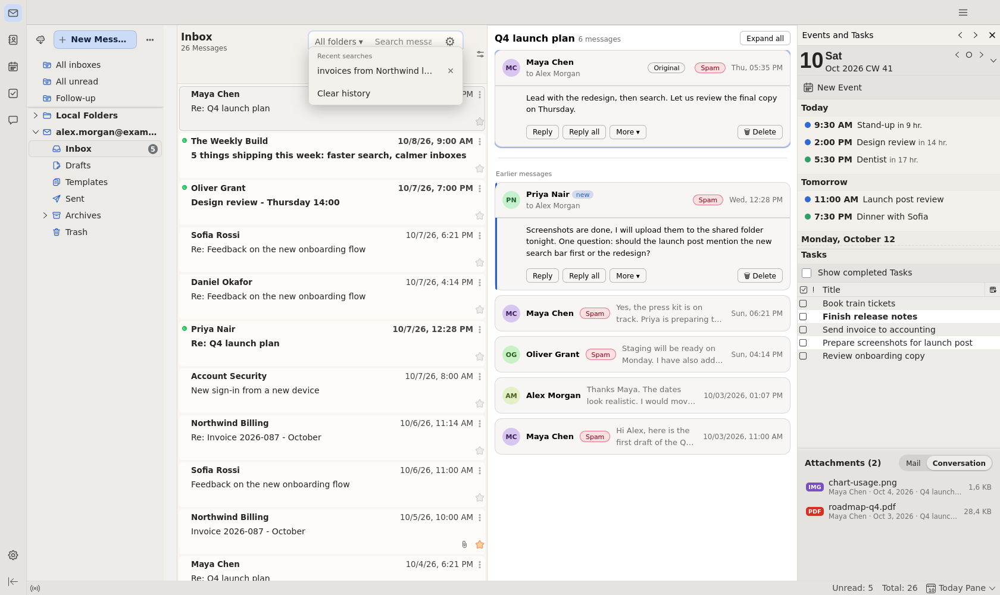
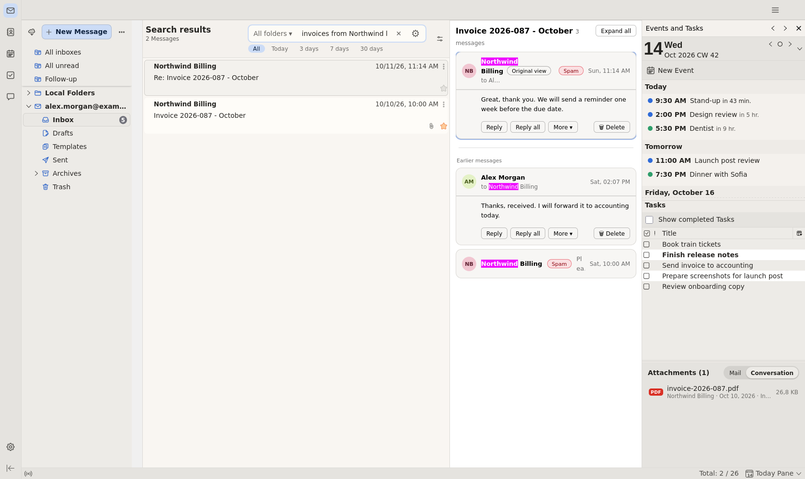
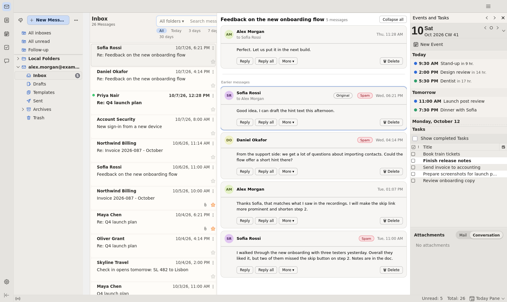

<h1 align="center">NovaBird 2.0</h1>

<b>A modern face and a much improved featureset for Thunderbird/Betterbird.</b> 
New in 2.0: AI assistant, search by meaning, team calendars.

<a href="#new-in-20">New in 2.0</a> ·
<a href="#bigger-fixes">Fixes</a> ·
<a href="#install">Install</a> ·
<a href="#the-add-ons">Add-ons</a> ·
<a href="#privacy">Privacy</a> ·
<a href="#disclaimer">Disclaimer</a> ·
<a href="HANDBOOK.md">Handbook</a> ·
<a href="README.de.md">Deutsch</a>

## New in 2.0

Everything new is optional. Details are in the [changelog](CHANGELOG.md).

### AI assistant
Off until you switch it on. Runs with Ollama, an OpenAI-compatible server or the NovaBird Helper. Every function can be switched off on its own.

- **Summary, translation, dates** for any mail. Nothing goes into the calendar until you save it.
- **"What's new?"** New mail at a glance: to do, for information, advertising. On a schedule if you like.
- **Write:** draft a reply, correct, change the tone or translate in the compose window.
- **Deadlines** from your mail, with a reminder.
- **Sorting (beta):** describe a folder in your own words, the AI moves new mail there. Start with suggestions, undo at any time.
- **Read aloud** in a natural voice (with the Helper).
- **Nothing twice in the calendar,** also across PCs and shared calendars.

### Search
- **Search by meaning (beta):** "parents meeting" finds the "parent-teacher evening". Computed in the add-on, or much faster with the Helper or Ollama.
- **Best matches first,** then by date.
- **Very large mailboxes:** with 1.2 million mails, a `from:` search takes 0.2 s instead of 25 s.
- **Better word forms** in French, Spanish and English.

### NovaBird Mail for Android (beta)
A fork of Thunderbird for Android that brings NovaBird to the phone. [To the repository](https://github.com/Novabird-Addons/NovaBird-Android)

- **Everyday-language search:** "from Petra in March with PDF" becomes filters. The index lives on the phone.
- **Search by meaning,** like on the PC.
- **Phishing protection:** checks sender, links, attachments and QR codes; risky links ask first.
- **AI with the Helper:** summary, "What's new?", reading aloud.
- **Large mailboxes:** loads all mail in one go over Wi-Fi, tested with 100,000 mails per account.
- **With the Helper:** pair without typing, search vectors from the PC's graphics card for all phones. Everything stays in your network.

Android 14 or newer, 64-bit.

### NovaBird Helper (optional, Windows)
A small program for the PC with the graphics card. [More about the Helper](novabird-helper/README.md)

- **Uses the graphics card** for search, language model and reading aloud.
- **One PC computes for several,** encrypted, in your own network.
- **Shared results:** a new PC with the same mailbox is indexed in minutes.
- **Pairing without typing a code:** compare a 6-digit number, done.
- **Team calendars** with read and write rights per user, no cloud needed.
- **Web interface** with its own users and groups, optional Windows service, encrypted backup.

### Simpler
- **Four add-ons instead of eight.** The index is part of Search, the themes are part of the Extension.
- **Updating from 1.x** keeps settings, search history, index and theme.
- **Setup assistant** on first start. Every step can be skipped.
- **Settings sorted by topic.**

## Bigger fixes

- **Very large mailboxes:** Search no longer reads through every folder at each start (with 1.8 million mails that took about 30 minutes).
- **Conversations:** switching within a thread shows the selected mail; attached images show under the text; the reply buttons stay visible; encrypted mails say so instead of looking empty.
- **Contacts:** restoring deleted contacts can no longer lose them, and merging keeps a restore point.
- **Search index:** folders and mails that could not be read are tried again instead of staying missing until the weekly check.
- **Team calendars:** clear messages when the Helper blocks a login or cannot be reached, instead of "no calendar shared".
- **Security:** a security test of the Helper with 89 attacks closed two holes (injected header lines, connections that never ended). Subject and sender of a mail can no longer slip instructions to the AI.

> 2.0 went through two code reviews, a security test of the Helper, tests with about 650 deliberately broken and hostile mails, crash tests while indexing, two PCs on the same mailbox, and automatic tests on macOS.
>
> **Plus about 80 smaller fixes**, all listed in the [changelog](CHANGELOG.md).

## What NovaBird is

Add-ons for [Betterbird](https://www.betterbird.eu/) and Thunderbird ESR that work together.

- **A fresh look:** three themes, each light and dark.
- **One search bar** that understands sentences in English, German, French and Spanish: `invoices from Northwind last 2 weeks`
- **Real conversations:** the whole thread in the reading pane, across all folders.
- **Undo send:** a countdown of 3–60 s after pressing Send.
- **Right pane:** agenda, tasks and attachments with instant preview.
- **Nova-Contact:** tag filters, bulk editing, merging duplicates, with a restore point.
- **One home for all settings:** Settings → NovaBird.

## The add-ons

| Add-on | Version | What it does |
|---|---|---|
| **[NovaBird-Search](novabird-search/README.md)** | 2.0.0 | Search bar, index, search by meaning |
| **[NovaBird-Conversation](novabird-conversation/README.md)** | 0.15.6 | Whole threads in the reading pane |
| **[NovaBird-Send](novabird-send/README.md)** | 1.0.4 | Undo send with queue |
| **[NovaBird-Extension](novabird-extension/README.md)** | 2.0.0 | Message list, right pane, themes, Nova-Contact, AI assistant, settings |
| **[NovaBird Helper](novabird-helper/README.md)** | 0.5.0 | Optional Windows program: graphics card, network, team calendars |

Every add-on works on its own. Together they do more.

## Install

1. **Requirements:** Betterbird or Thunderbird **ESR** 128 or newer. The add-ons use experiment APIs, which do not run in the monthly Thunderbird release.
2. Add-ons manager → gear → **Install Add-on From File…**, select all `.xpi` files, restart.
3. On the first start the setup assistant opens and NovaBird-Search builds its index once (about 6 minutes for 75,000 messages). You can keep working meanwhile.

> **Please read the [disclaimer](#disclaimer) first:** unofficial, experimental, use at your own risk, back up your profile.
>
> These are unsigned builds. If you used the earlier "Pilot" or "Stream" add-ons, remove them first. Never run an old and a new version of the same add-on side by side.

## Uninstall

Remove the add-ons in the add-ons manager and you are back on plain Thunderbird.

## Privacy

NovaBird runs on your computer. The network is only used where you switch it on:

- **AI assistant:** the mail text goes to the server you choose. With Ollama on your PC or the Helper it stays with you.
- **Search by meaning:** one model download from Hugging Face, checked against fixed checksums. If you use your own server, the mail text goes there.
- **NovaBird Helper:** talks to your paired PCs, mail text and vectors encrypted. It downloads models and tools only on request.
- **Online updates:** off by default. Asks GitHub for new versions and sends no data from Thunderbird.

The search index holds the text of your mail in plain form inside your profile folder, just like Betterbird's own index. You can delete it at any time in the search settings.

## Status

Young and under active development, used daily but not tested on every setup. French and Spanish texts are not yet reviewed by native speakers. Bug reports and ideas are very welcome (issues).

## Building from source

Each add-on folder has a `build.sh`. Unit tests: the index in `novabird-search/db` (`npm install && npm test`), the others `node --test tests/*.test.js`.

## License

MIT, see [LICENSE](LICENSE). The screenshots show invented demo data.

## Disclaimer

> [!WARNING]
> **Unofficial and experimental.** NovaBird is an independent community project. It is not affiliated with, endorsed or supported by Betterbird, Thunderbird or MZLA Technologies Corporation, so please do not report NovaBird problems to their teams. The add-ons rely on unsupported *Experiment APIs* that can break with any Betterbird or Thunderbird update.
>
> They are mostly tested with Betterbird 153 ESR and Linux only, though some basic Windows testing turned up "ok" - mainly with test data. IMAP accounts and some features are not fully tested and can show bugs.
>
> Provided "as is", without warranty (see [LICENSE](LICENSE)) - hence **use at your own risk and back up your profile before installing.**
