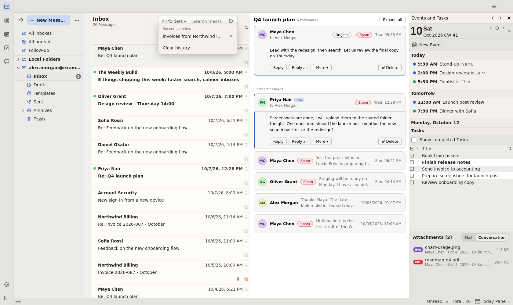
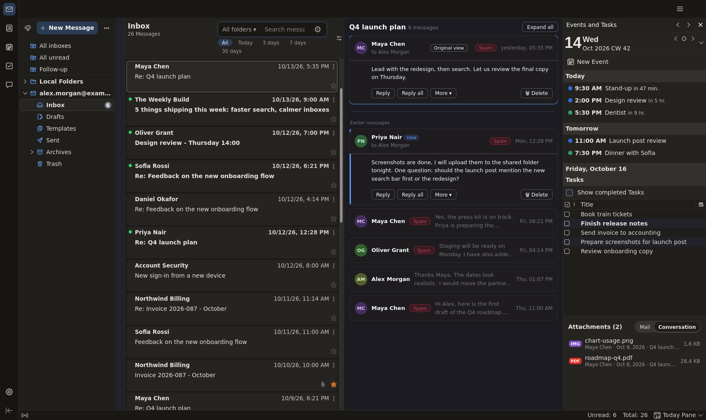
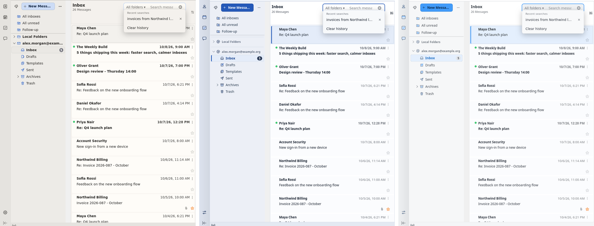
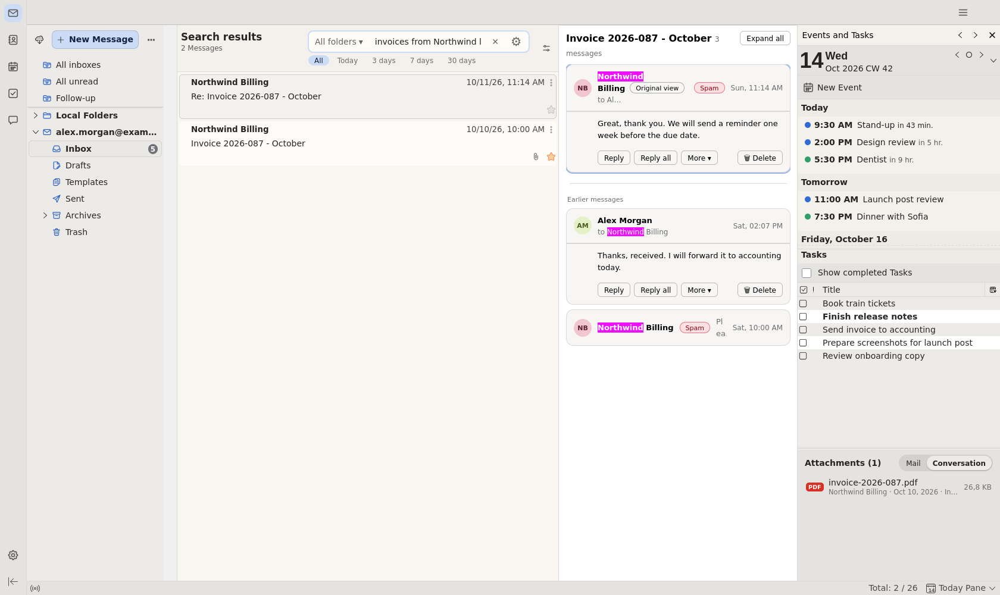
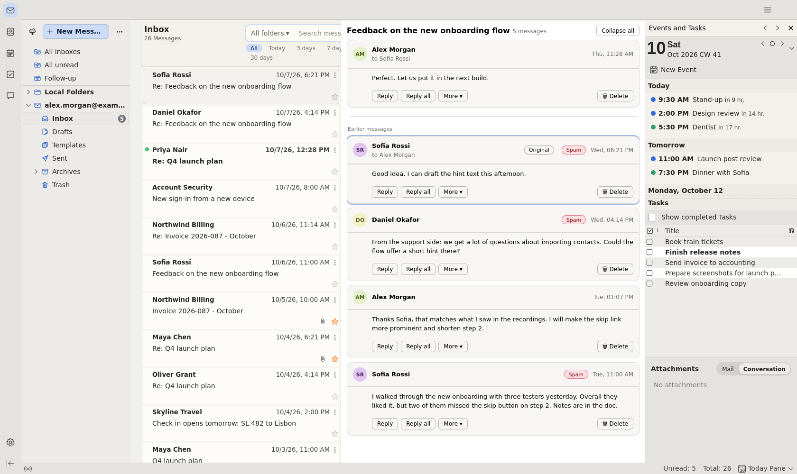
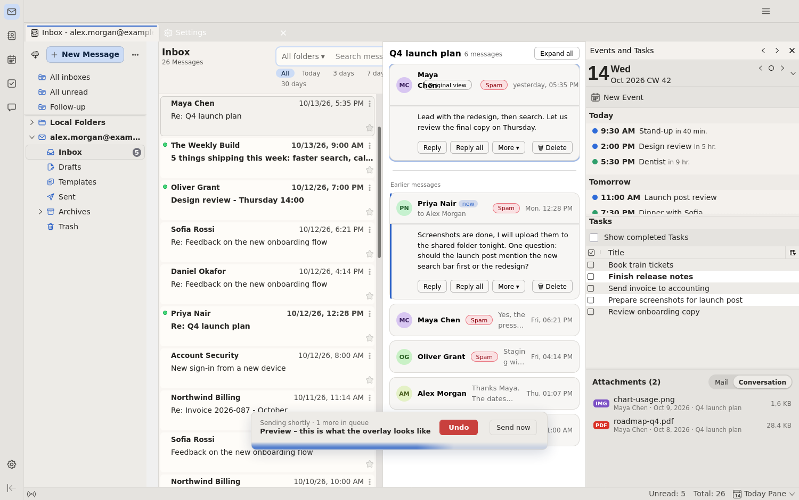
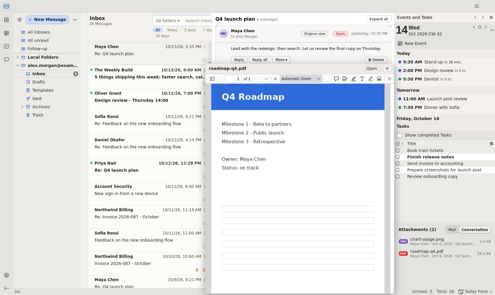
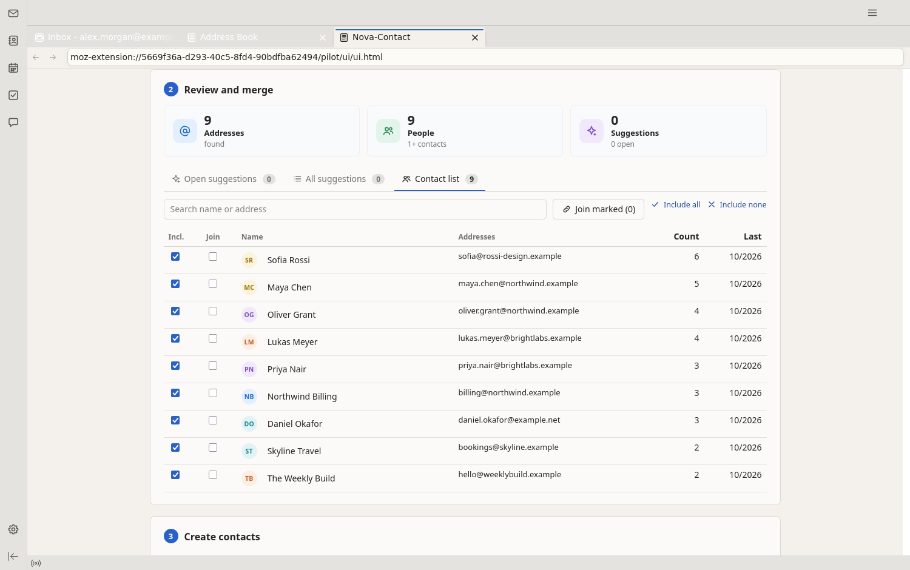
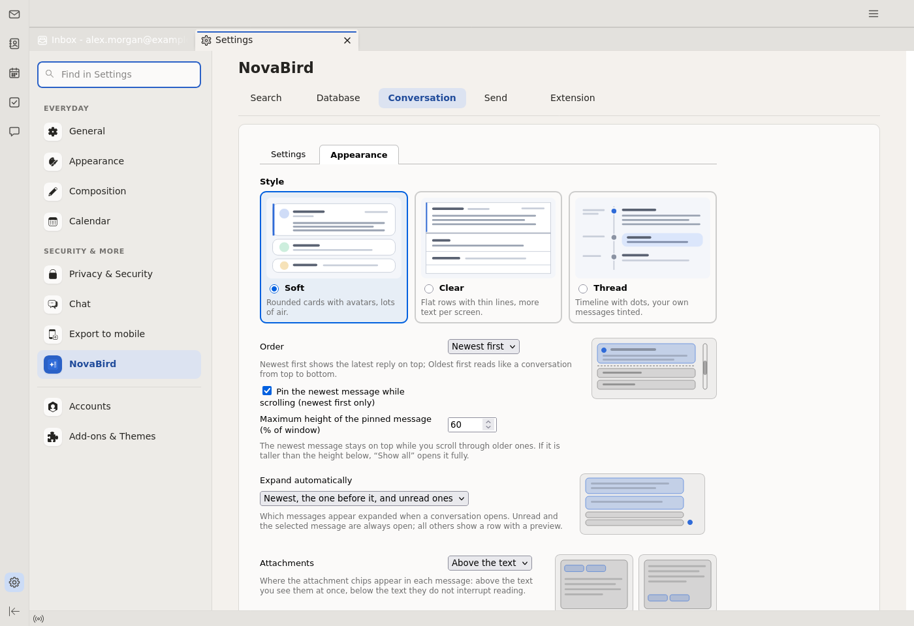

<h1 align="center">NovaBird</h1>

<b>A modern face and a much improved featureset for Betterbird.</b> 
A redesigned interface, one unified search bar on top of an upgraded database, 
a real conversation view, undo-send and a calmer calendar and address book.

<a href="HANDBOOK.md">Handbook</a> ·
<a href="#install">Install</a> ·
<a href="#uninstall">Uninstall</a>
<a href="#the-add-ons">Add-ons</a> ·
<a href="#disclaimer">Disclaimer</a> ·
<a href="README.de.md">Deutsch</a>

NovaBird is a family of add-ons for [Betterbird](https://www.betterbird.eu/) (and Thunderbird ESR) where all addons work together. Everything runs locally; nothing leaves your computer.

## What you get

### A fresh look, almost everywhere
Folder pane, card-style message list, mail tab, settings, accounts and the add-ons manager follow one consistent design language. Three hand-tuned themes, each in light and dark, and the colors carry through to dialogs and the compose window.

### One search bar, not two
Global search and quick filter become **one field** at the top of the message list. Results appear while you type, strictly newest first. Powered by **NovaBird-DB**, an own SQLite/FTS5 index that replaces* Gloda for search results: it finds mail across all accounts and folders in a fraction of a second, even in a mailbox of 75,000 messages, and it understands sentences:

> `invoices from Northwind last 2 weeks` · `unread mail with pdf since March` · `what did Maya send me`

…in **English, German, French and Spanish**. Plus operators (`from:` `to:` `subject:` `since:`), "Did you mean…?", search history and an analysis page with timeline and filters.
\*Thunderbird's own database (Gloda) keeps running and is not uninstalled or replaced as a whole.

### Conversations that read like conversations
Open any message and the whole thread is there: the newest message pinned on top, older ones as one-line cards, unread ones expanded. Across all folders, including Sent. Reply, forward, delete and mark as spam right in the thread. Three styles, mail styles never leak in, and external images load only on your click.

### Undo send
Press Send and a small countdown appears (3–60 s). **Undo** brings the compose window back exactly as it was, **Send now** skips the wait, and several messages queue up. Quit while messages wait and they are saved as drafts.

### A smarter right-hand pane
Agenda, tasks and an **attachments panel** for the selected message or the whole thread. Hover over a PDF or an image for an instant, scrollable preview.

### Calendar and address book
Calendar dialogs and views pick up your theme. **Nova-Contact** adds tag filters, bulk editing with undo, and a helper that collects addresses from your mail, merges duplicates and cleans up the address book safely (with a restore point).

 

### One home for all settings
**Settings → NovaBird** collects the options of every installed NovaBird add-on in tabs. Every option is explained, many with a small sketch.

## The add-ons

| Add-on | What it does |
|---|---|
| **[NovaBird-Search](novabird-search/README.md)** | The unified search bar, history, analysis, shared folders |
| **[NovaBird-DB](novabird-db/README.md)** | Fast full-text index and the sentence parser (DE, EN, FR, ES) |
| **[NovaBird-Conversation](novabird-conversation/README.md)** | Whole threads in the reading pane |
| **[NovaBird-Send](novabird-send/README.md)** | Undo send with queue |
| **[NovaBird-Extension](novabird-extension/README.md)** | Message list (Soft, Clear, Thread; three densities and per-account colours), right pane, attachment preview, Nova-Contact, new-style settings, the NovaBird settings page |
| **[NovaBird-Sand / -Cobalt / -Springlight](novabird-themes/README.md)** | The themes |

They cooperate loosely: Search and Conversation use the DB if it is installed (and fall back to Betterbird's own index if not); the Extension takes its colors from the active theme. None of them requires another.

## Install

1. **Requirements:** Betterbird or Thunderbird **ESR** 128 or newer. The add-ons use experiment APIs, which do not run in the monthly Thunderbird release.
2. Download the `.xpi` files from the [latest release](../../releases/latest).
3. In the add-ons manager choose the gear → **Install Add-on From File…** for each file. Suggested order: **DB**, Search, Conversation, Send, Extension; themes under *Themes*. Restart Betterbird.
4. On the first start NovaBird-DB builds its index once (about 6 minutes for 75,000 messages, with a progress indicator). Betterbird stays usable meanwhile.

> **Please read the [disclaimer](#disclaimer) first:** unofficial, experimental, use at your own risk, back up your profile.
>
> These are unsigned builds. If you used the earlier "Pilot" or "Stream" add-ons, remove them first. Never run an old and a new version of the same add-on side by side.

## Uninstall
Since NovaBird is just based on addons you can simply remove NovaBird and you can go back to Thunderbird any time you want.

## Privacy

Everything is local, no add-on uses the network. The search index contains the text of your mail in plain form inside your profile folder, just like Betterbird's own index does; protect your disk accordingly. You can delete the index at any time from the NovaBird-DB settings.

## Status and roadmap

NovaBird is young and under active development; it is used daily but not battle-tested on every setup. French and Spanish texts are written with care but not yet reviewed by native speakers. Bug reports and ideas are very welcome (issues).

Planned: more screenshots and docs, synonyms and abbreviations for search, further languages for the sentence parser.

## Building from source

Each add-on folder has a `build.sh`. Unit tests: `novabird-db` (`npm install && npm test`), the others `node --test tests/*.test.js`.

## License

MIT, see [LICENSE](LICENSE). The screenshots show invented demo data.

## Disclaimer

> [!WARNING]
> **Unofficial and experimental.** NovaBird is an independent community project. It is not affiliated with, endorsed or supported by Betterbird, Thunderbird or MZLA Technologies Corporation, so please do not report NovaBird problems to their teams. The add-ons rely on unsupported *Experiment APIs* that can break with any Betterbird or Thunderbird update.
>
> They are mostly tested with Betterbird 153 ESR and Linux only, though some basic Windows testing turned up "ok" - mainly with test data. IMAP accounts and some features are not fully tested and can show bugs.
>
> Provided "as is", without warranty (see [LICENSE](LICENSE)) - hence **use at your own risk and back up your profile before installing.**
