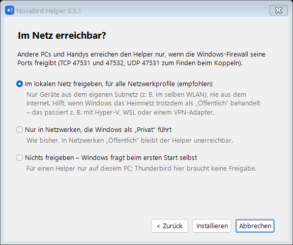
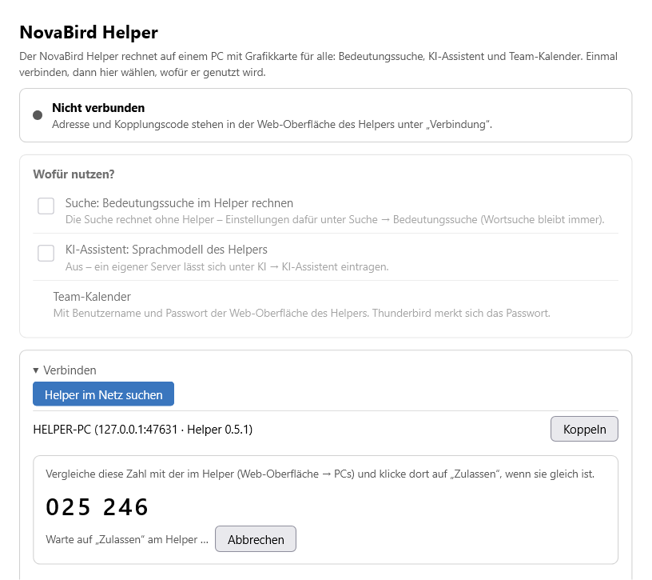
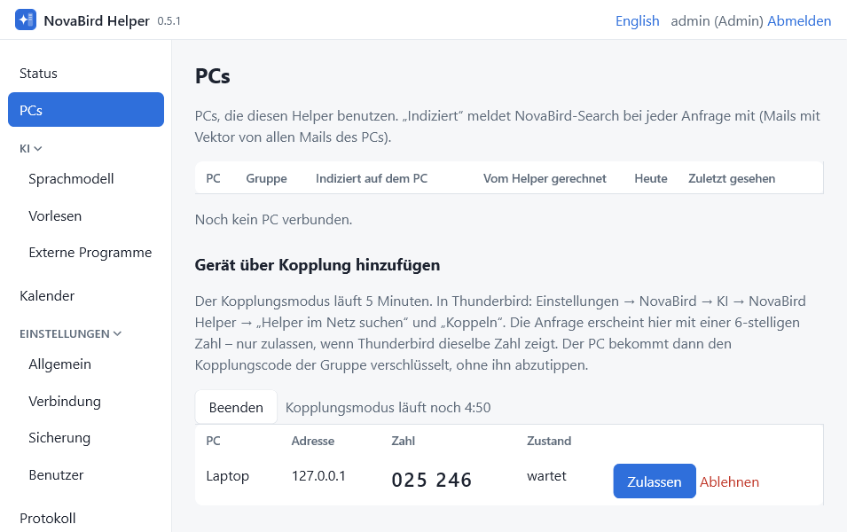
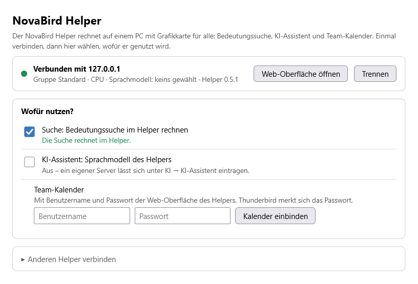

# NovaBird Helper – Kurzanleitung

Der Helper ist ein kleines Windows-Programm für den PC mit der Grafikkarte. Er rechnet für NovaBird die Suche nach Bedeutung,
den KI-Assistenten und das Vorlesen – für diesen PC und auf Wunsch für weitere PCs und Handys im eigenen Netz. Er ist
optional: Ohne Helper funktioniert alles, nur langsamer. Stand: Helper 0.5.1. [English version](helper-guide.md)

## 1. Installieren (auf dem PC mit Grafikkarte)

1. `NovaBird-Helper-…-win-x64.exe` von den [Releases](https://github.com/Novabird-Addons/NovaBird/releases) laden und
   doppelklicken. Installiert wird nur für dein Windows-Konto, ohne Adminrechte.
2. **Admin anlegen:** Name und Passwort (mindestens 10 Zeichen). Sie gelten nur für die Web-Oberfläche des Helpers, nicht
   für Windows.
3. **Im Netz erreichbar?** Sollen andere PCs oder Handys mitrechnen lassen: „Im lokalen Netz freigeben“. Nur für diesen PC:
   „Nichts freigeben“. Windows fragt dafür einmal nach Adminrechten.

   

4. **Installieren.** Danach öffnet sich die Web-Oberfläche und führt durch die Einrichtung: Suchmodell laden (etwa
   320 MB), Grafikkarte messen, auf Wunsch Sprachmodell und Vorlesen. Jeder Schritt lässt sich überspringen.

Der Helper sitzt dann als Symbol im Infobereich; ein Klick darauf öffnet die Web-Oberfläche. Wieder starten geht über das
Startmenü **„NovaBird Helper (Netz)“** – läuft er schon, öffnet sich die Web-Oberfläche.

## 2. Thunderbird verbinden (auf jedem PC, auch auf dem Helper-PC selbst)

1. **Am Helper:** Web-Oberfläche → **PCs** → **„Kopplungsmodus starten“**. Er läuft 5 Minuten.
2. **In Thunderbird:** Einstellungen → NovaBird → KI → **NovaBird Helper** → „Verbinden“ → **„Helper im Netz suchen“** →
   **„Koppeln“**. Im Feld „Name dieses PCs“ weiter unten kannst du vorher einen Namen für die PC-Liste eintragen.
3. Thunderbird zeigt eine **6-stellige Zahl**:

   

4. **Am Helper** steht dieselbe Zahl. Nur wenn sie gleich ist: **„Zulassen“**.

   

5. **Wofür nutzen?** Häkchen bei *Suche* und/oder *KI-Assistent*. Team-Kalender bindest du hier mit dem Namen und Passwort
   eines Benutzers der Web-Oberfläche ein.

   

**Kein Helper gefunden?** (z. B. anderes Subnetz, VPN) Unten auf derselben Seite „Oder von Hand“: **Adresse** und
**Kopplungscode** eintragen – beides steht in der Web-Oberfläche unter **Verbindung**.

**Handy:** [NovaBird Mail für Android](https://github.com/Novabird-Addons/NovaBird-Android) koppelt genauso:
Kopplungsmodus am Helper starten, im Handy suchen, Zahl vergleichen, zulassen.

## 3. Optional: als Windows-Dienst

Web-Oberfläche → Einstellungen → Allgemein → **„Als Windows-Dienst einrichten …“** (oder Rechtsklick auf das Symbol).
Windows fragt einmal nach Adminrechten; Einstellungen, Kopplung und Modelle werden übernommen. Der Helper läuft dann auch,
wenn niemand an Windows angemeldet ist. Das Symbol zeigt nur noch den Zustand; Startmenü und Doppelklick auf die installierte
`nbhelper.exe` starten es von selbst (ab 0.5.1). Zurück geht es per Rechtsklick auf das Symbol →
„Zurück zum Programm im Benutzerkonto …“.

## Gut zu wissen

- **Verschlüsselt:** Alles zwischen Thunderbird, Handy und Helper ist mit dem Kopplungscode verschlüsselt und bleibt im
  eigenen Netz.
- **Aktualisieren:** die neue `nbhelper.exe` doppelklicken → „ersetzen?“ → Ja. Einstellungen, Kopplung und Modelle bleiben.
- **Entfernen:** Windows-Einstellungen → Apps → Installierte Apps → NovaBird Helper.
- Die Bilder zeigen einen Test-Helper mit anderem Port (47631); normal sind 47531 (PCs) und 47532 (Web-Oberfläche).
- Alles Weitere (Gruppen, Benutzer, Sprachmodelle, Vorlesen, Technik): [Helper-README](../novabird-helper/README.md).
