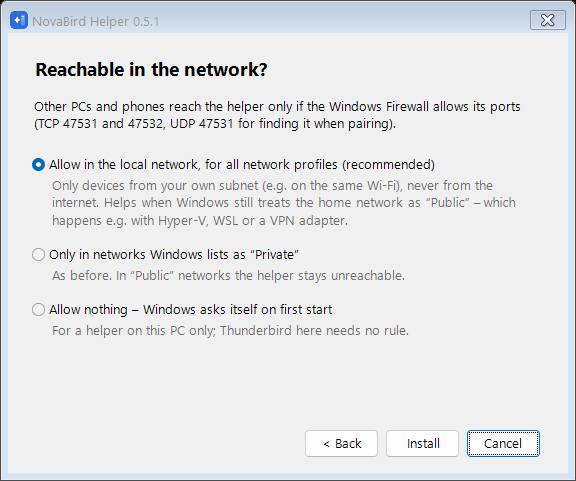
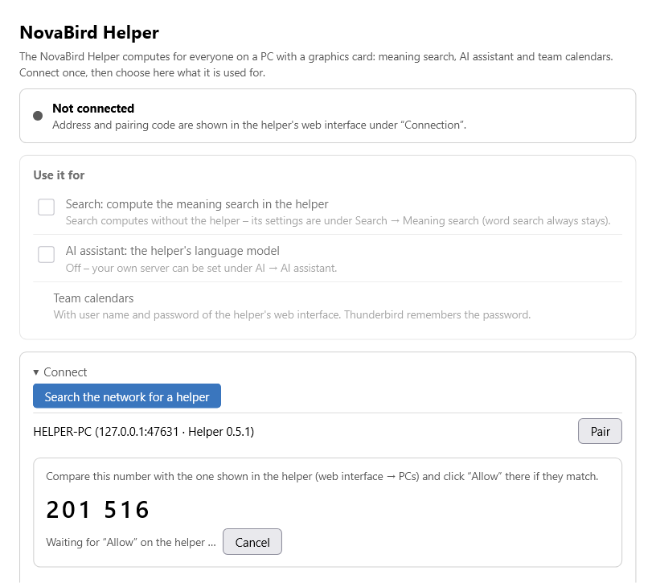
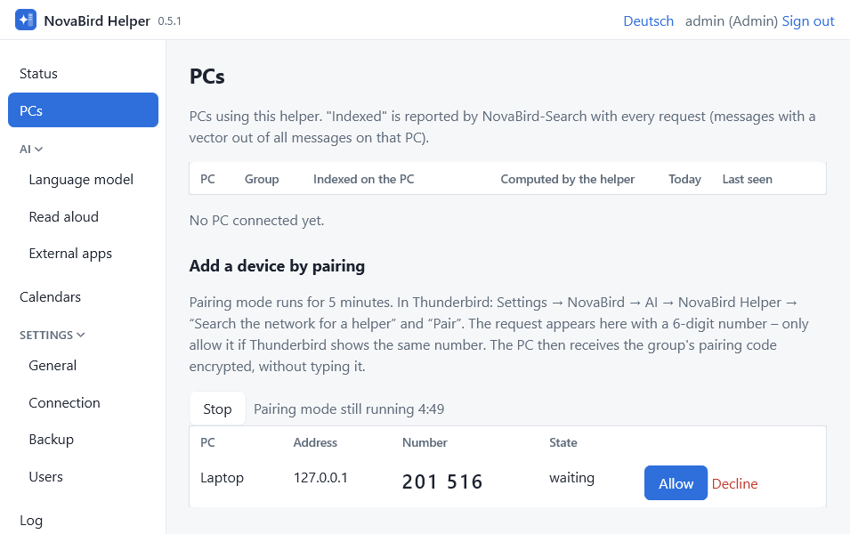
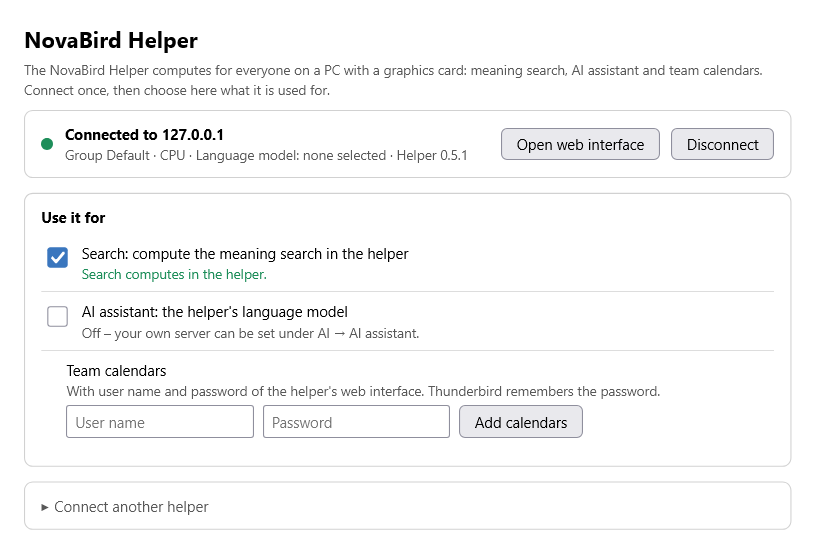

# NovaBird Helper – quick guide

The Helper is a small Windows program for the PC with the graphics card. It computes the meaning search, the AI assistant and
read-aloud for NovaBird – for this PC and, if you like, for other PCs and phones in your own network. It is optional:
everything works without it, only slower. Applies to Helper 0.5.1. [Deutsche Fassung](helper-anleitung.md)

## 1. Install (on the PC with the graphics card)

1. Download `NovaBird-Helper-…-win-x64.exe` from the [releases](https://github.com/Novabird-Addons/NovaBird/releases) and
   double-click it. It installs for your Windows account only, without admin rights.
2. **Create an admin:** name and password (at least 10 characters). They are only for the Helper's web interface, not
   for Windows.
3. **Reachable in the network?** If other PCs or phones should use it: "Allow in the local network". For this PC only:
   "Allow nothing". Windows asks for admin rights once for this.

   

4. **Install.** The web interface then opens and walks you through the setup: download the search model (about 320 MB),
   measure the graphics card, optionally language model and read-aloud. Every step can be skipped.

The Helper then sits as an icon in the notification area; clicking it opens the web interface. To start it again, use the
Start menu entry **"NovaBird Helper (Netz)"** – if it is already running, the web interface opens.

## 2. Connect Thunderbird (on every PC, including the Helper PC itself)

1. **On the Helper:** web interface → **PCs** → **"Start pairing mode"**. It runs for 5 minutes.
2. **In Thunderbird:** Settings → NovaBird → AI → **NovaBird Helper** → "Connect" → **"Search the network for a helper"** →
   **"Pair"**. In the field "Name of this PC" further down you can first enter a name for the list of PCs.
3. Thunderbird shows a **6-digit number**:

   

4. **The Helper** shows the same number. Only if it matches: **"Allow"**.

   

5. **Use it for:** tick *Search* and/or *AI assistant*. Team calendars are added here with the name and password of a user
   of the web interface.

   

**No helper found?** (e.g. another subnet, VPN) Further down on the same page, "Or by hand": enter **address** and
**pairing code** – both are in the web interface under **Connection**.

**Phone:** [NovaBird Mail for Android](https://github.com/Novabird-Addons/NovaBird-Android) pairs the same way: start
pairing mode on the Helper, search on the phone, compare the number, allow.

## 3. Optional: as a Windows service

Web interface → Settings → General → **"Set up as Windows service …"** (or right-click the icon). Windows asks for admin
rights once; settings, pairing and models are taken over. The Helper then runs even when nobody is signed in to Windows.
The icon only shows the state; the Start menu and a double-click on the installed `nbhelper.exe` start it by themselves
(from 0.5.1). To go back: right-click the icon → "Back to the program in the user account …".

## Good to know

- **Encrypted:** everything between Thunderbird, phone and Helper is encrypted with the pairing code and stays in your own
  network.
- **Update:** double-click the new `nbhelper.exe` → "replace?" → Yes. Settings, pairing and models are kept.
- **Remove:** Windows Settings → Apps → Installed apps → NovaBird Helper.
- The pictures show a test Helper on a different port (47631); normally it is 47531 (PCs) and 47532 (web interface).
- Everything else (groups, users, language models, read-aloud, technical details): [Helper README](../novabird-helper/README.md) (German).
